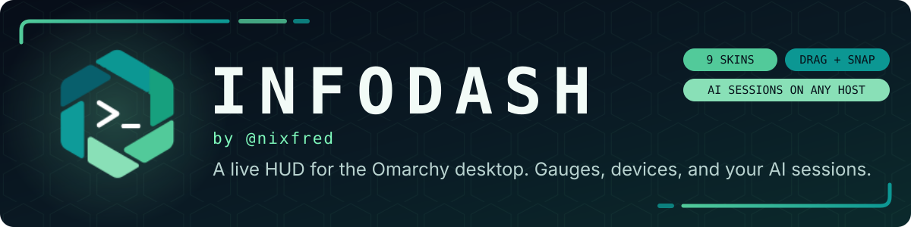
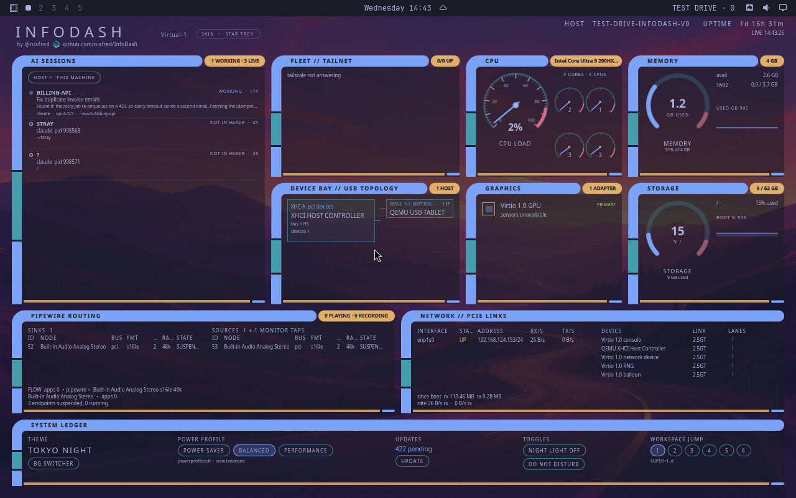
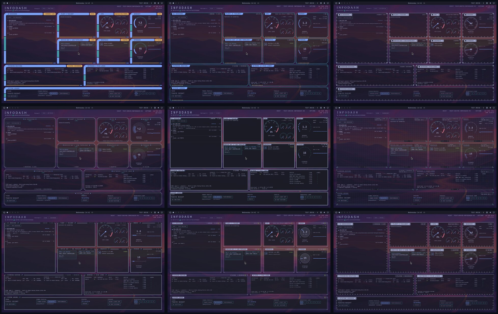
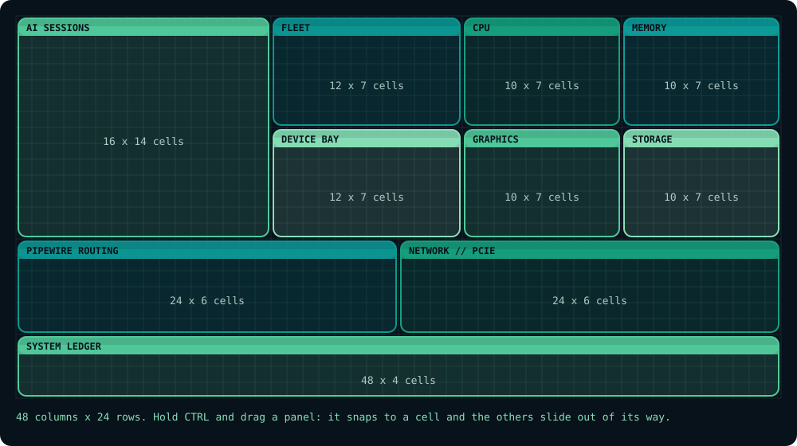
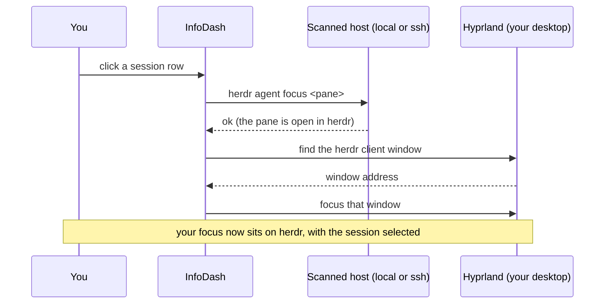
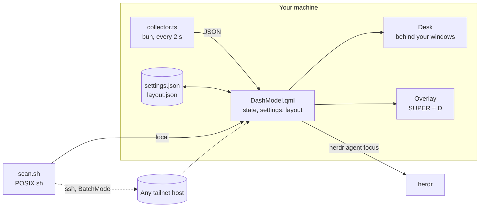

<p align="center">
  
</p>

<p align="center">
  <a href="LICENSE"></a>
  
  
  
  
</p>

**InfoDash** paints a full live dashboard over your [Omarchy](https://omarchy.org) wallpaper: a CPU speedometer with a dial for every CPU, memory, GPU and storage gauges, USB topology, network and PCIe links, PipeWire routing, your tailnet, and the **AI coding sessions** running on this machine or on any other machine you can ssh to. One key hides your windows behind it. Another key shows or hides the panels.



> **Colours always follow your Omarchy theme.** Skins change the shape, the type and the gauge style. They never choose a colour, so every theme switch restyles the whole dashboard.

---

## What you get

| | |
|---|---|
| **Nine skins** | Star Trek (the default), Cyberpunk, Steampunk, Art Deco, 8-bit, Blueprint, Nostromo, Cassette, Diesel. One small chip in the header switches them. |
| **CPU speedometers** | One big needle speedometer for total load, with temperature and average clock under it, and a small one for every logical CPU. The grid always fills its rows, and anything past 85% turns red. |
| **Drag and snap layout** | Hold `CTRL`, drag a panel to move it, drag an edge or corner to resize it. It snaps to a 48 x 24 grid and the other panels slide out of the way. Saved per monitor. |
| **AI sessions on any host** | Every Claude Code, Codex and other agent session with its status, title, model and last message. Point the panel at any tailnet machine from the host picker. |
| **Click to jump** | With [herdr](https://github.com/ogulcancelik/herdr), clicking a session selects it in herdr and moves *your* focus to the herdr window. A session that is not open in herdr is shown but does nothing. |
| **Summon overlay** | A fullscreen twin of the dashboard that appears over whatever you are doing, and a clear-desk mode that hides the current app behind it. |
| **Its own text size** | A text size control for InfoDash alone (80% to 150%), separate from the system font. |
| **One brightness** | All text is the same brightness. Hierarchy comes from size, weight and caps, never from dimming. |
| **Read-only** | The collector only reads `/proc`, `/sys` and a few status commands. It writes nothing outside its own settings folder. |

## The nine skins



| Skin | Look |
|---|---|
| **Star Trek** (default) | Rounded elbows and pills, ring gauges |
| **Cyberpunk** | Chamfered corners, hazard stripes, arc gauges |
| **Steampunk** | Riveted plates, a gear banner, needle gauges |
| **Art Deco** | Stepped corners, sunburst, fan gauges |
| **8-bit** | Pixel borders, block-chain gauges |
| **Blueprint** | Drafting grid, dimension lines, a title block |
| **Nostromo** | CRT box with scanlines, block-bar gauges |
| **Cassette** | Bezel, screws, label strip, knob gauges |
| **Diesel** | Steel plate, rivets, data plate, needle gauges |

Pick one from the `SKIN` chip next to the monitor name. The strip is an even grid, hover shows a one-line hint, and `Esc` closes it. From a key binding: `omarchy-shell infodash cycleSkin`.

---

## Install

You need Omarchy (Hyprland with the Lua config, plus Quickshell) with the plugin system enabled, and [bun](https://bun.sh) for the collector.

```sh
git clone https://github.com/nixfred/InfoDash ~/.config/omarchy/plugins/nixfred.infodash
omarchy plugin enable nixfred.infodash
```

While it is enabled, InfoDash replaces the stock background plugin. Disabling it (`omarchy plugin disable nixfred.infodash`) restores the stock one.

### Bind two keys

Add these to `~/.config/hypr/bindings.lua`, with any keys you like:

```lua
o.bind("SUPER + D", "InfoDash: hide the app / bring it back", "omarchy-shell shell toggle nixfred.infodash '{}'")
o.bind("SUPER + I", "InfoDash: show/hide the panels",         "omarchy-shell infodash toggleDashboard")
```

| Key | What it does |
|---|---|
| `SUPER + D` | Hides the app you are in behind a clear background with InfoDash on it. Press again to bring the app back. |
| `SUPER + I` | Shows or hides only the InfoDash panels, on whichever layer is up. It never brings the app back. |

### Update

```sh
git -C ~/.config/omarchy/plugins/nixfred.infodash pull
omarchy restart shell
```

### Optional extras

InfoDash shows what it can find and skips the rest.

| Tool | Used for |
|---|---|
| `tailscale` | the fleet panel, and AI sessions from other machines |
| `nvidia-smi` | NVIDIA GPU panel |
| `pactl` | the PipeWire panel |
| `checkupdates` | the pending-updates count |
| `herdr` | click a session to jump to it |

---

## Using it

| Action | How |
|---|---|
| Move a panel | hold `CTRL`, drag it |
| Resize a panel | hold `CTRL`, drag an edge or corner |
| Cancel a drag | `Esc` |
| Reset the layout | `CTRL` + double-click the title |
| Change skin or text size | click the `SKIN` chip in the header |
| Show the AI sessions of another machine | the `HOST` chip in the AI SESSIONS panel |
| Open the project page | click the repo address under the title |
| Open nixfred.com | click `by @nixfred` |

### The layout grid

Panels live on a 48 x 24 grid. Move one onto another and the other slides aside; resize one and its neighbours make room. The default layout:



The layout is stored once per monitor and shared by every skin, so switching skins never rearranges your desk.

---

## AI sessions

The biggest panel is a live list of your coding agents. Each row shows:

1. the herdr workspace name and the status (`BLOCKED`, `WORKING`, `IDLE`, `DONE`) with how long ago it last moved
2. the session title
3. the last thing the agent said (a short snippet from its transcript)
4. the agent, model and working folder

Rows are ordered blocked, then working, then idle, then done, newest first. Agent processes that herdr does not know about appear as `NOT IN HERDR` rows.

**When the link drops.** If the ssh connection to the scanned host fails while you are watching it, the panel keeps the last sessions it saw instead of clearing them, and says so: the tag becomes `LINK LOST`, a red line next to the host chip shows how long ago the host was last seen, every row reads `LAST SEEN WORKING` (or idle, or blocked) instead of a live status, the working dot stops pulsing, and rows stop being clickable. A host that is up and idle never looks like that. The next successful scan, every 5 seconds, puts the live view back.

**Looking at another machine.** Click the `HOST` chip and pick any machine on your tailnet. InfoDash runs the scan there over `ssh` (a persistent, non-interactive connection), so you can watch the work happening on a build box while you sit at your laptop.

**Click to jump.** Clicking a row that is open in herdr does two things: it selects that session in herdr on the machine where it runs, then finds the herdr window on *your* machine and focuses it. If the session is not in herdr, nothing happens (InfoDash never opens one for you).



The window is found by what is running inside it (a herdr client, or an `ssh` to that host), never by its title alone, because any web page can set a window title.

---

## Settings

`~/.config/omarchy/infodash/settings.json`, written by the UI (delete it to start over):

| Key | Meaning |
|---|---|
| `skin` | one of `startrek cyberpunk steampunk deco 8bit blueprint nostromo cassette diesel` |
| `fontScale` | InfoDash text and UI size, 0.8 to 1.5 |
| `aiHost` | tailnet host whose AI sessions are shown; empty means this machine |
| `fleet` | optional list of tailnet host names to pin in the fleet panel (default: the first 8 peers) |
| `fleetIgnore` | optional list of tailnet host names never to show, for example a machine that belongs to another network |
| `snippetStrip` | optional regular expression removed from the start of each last-message snippet, for agents that begin every reply with a banner |

Panel layouts are in `layout.json` in the same folder, one layout per monitor name.

### Command line

Everything is scriptable through `omarchy-shell infodash <command>`:

| Command | Does |
|---|---|
| `toggleDashboard` | show or hide the panels |
| `setDashboardVisible <on/off>` | set it explicitly |
| `setSkin <id>` / `getSkin` | choose or read the skin |
| `cycleSkin` / `prevSkin` | next or previous skin |
| `listSkins` | all skins, as JSON |
| `setFontScale <0.8-1.5>` / `getFontScale` | text size |
| `setAiHost <name>` / `getAiHost` | which machine the AI panel watches |
| `aiSessions` | the current session list, as JSON |
| `focusAi <pane>` | jump to a herdr pane, same as clicking its row |
| `status` | version, skin, host and health, as JSON |

---

## How it works



- **`collector.ts`** reads `/proc`, `/sys` and a few commands and prints one JSON snapshot every two seconds. It exits when the shell that started it goes away.
- **`DashModel.qml`** holds everything the views share: colours from your Omarchy theme, settings, layouts, the AI scan.
- **The desk** is a layer-shell surface behind your windows; **the overlay** is a fullscreen surface above them. Both draw the same view and share the same state.
- **`Layout.js`** is the grid engine (pure functions, unit-tested), **`Skins.js`** the skin registry (one `Skin*.qml` frame per skin), **`Ai.js`** and **`scan.sh`** the session scan and parsing.

---

## Privacy and security

- The AI panel reads the **last assistant message** of each Claude Code session from its transcript on the machine being scanned and shows a short snippet on your desktop. The snippet is cached under `~/.cache/infodash` (mode `0600`) on the scanned machine and pruned after a week.
- Remote scans use your normal ssh setup with `BatchMode`: they never prompt and never store a password. They run with agent, X11 and port forwarding off, under a timeout, with the output size capped.
- Text that came from a transcript or a remote machine is shown as plain text, with control and bidirectional-override characters removed.
- The two header links open only the addresses written in the code, in your default browser.
- The collector never writes outside its settings folder and the runtime directory.

## Troubleshooting

| Problem | Try |
|---|---|
| The panels show `COLLECTING...` | check that `bun` is installed (`which bun`) and run `omarchy restart shell` |
| `UPDATING` instead of `LIVE` | the collector missed a tick; it recovers on its own, `omarchy restart shell` if it does not |
| `LINK LOST` in the AI sessions panel | the ssh connection to that host failed; the rows are the last ones seen. It clears by itself when the host answers again |
| AI sessions panel is empty on another host | check that plain `ssh <host>` works without a prompt (key auth), and that the host runs herdr or an agent |
| Clicking a session does nothing | the session is not open in herdr, or herdr is not installed on that host |
| Text too small or too large | `SKIN` chip, then `A-` / `A+` (80% to 150%) |
| Panels in the wrong place | `CTRL` + double-click the title to reset the layout |
| Want the stock wallpaper back | `omarchy plugin disable nixfred.infodash` |

`qs log` shows the shell's messages; look for lines naming `nixfred.infodash`.

## Development

```sh
bun test      # layout engine, AI-session parsing, window matching, the scan script
```

QML plus a small bun collector. The plugin cannot be verified by unit tests alone: try changes in a throwaway Omarchy VM before your desktop. Pull requests and issues are welcome at [github.com/nixfred/InfoDash](https://github.com/nixfred/InfoDash).

## Credits

Built by [@nixfred](https://nixfred.com). Started from the overlay and wallpaper code of [Infomarchy](https://github.com/nixfred/infomarchy).

## License

MIT, see [LICENSE](LICENSE).
